<div align="center">

# PMS-X

**레거시 화면의 버튼 하나가 어떤 함수·API·SQL·테이블로 이어지는지 한눈에 보여 주는<br/>SI·SM 통합 프로젝트 관리 시스템**


<sub>As-Is 화면 분석 뷰어 — 캡처 위 ⑥ 저장 버튼을 누르면 <code>fn_save()</code> → <code>POST /hr/emp/save.do</code> → <code>EmpController</code> → <code>EmpService</code> → <code>insertEmp</code> → <code>TB_EMP</code>(C) 흐름이 펼쳐진다</sub>

</div>

---

## 목차
1. [왜 PMS-X 인가](#1-왜-pms-x-인가)
2. [핵심 기능](#2-핵심-기능)
3. [As-Is 화면 분석은 어떻게 동작하나](#3-as-is-화면-분석은-어떻게-동작하나)
4. [아키텍처](#4-아키텍처)
5. [화면 둘러보기](#5-화면-둘러보기)
6. [빠른 시작](#6-빠른-시작)
7. [새 시스템 As-Is 추가하기](#7-새-시스템-as-is-추가하기)
8. [저장소 구조](#8-저장소-구조)
9. [문서](#9-문서)
10. [품질·검증](#10-품질검증)
11. [로드맵](#11-로드맵)

---

## 1. 왜 PMS-X 인가

SI 구축과 SM 운영 현장에서 가장 시간이 많이 드는 일은 **"이 화면, 이 버튼이 실제로 무엇을 하는가"** 를 파악하는 것이다. 문서는 낡고, 담당자는 바뀌고, 소스는 수천 개다.

| 기존 방식 | PMS-X |
|---|---|
| 화면정의서·프로그램 사양서를 사람이 엑셀로 작성 | 소스·DB·화면을 **자동 수집**해 뷰어로 보고, 산출물은 **자동 출력** |
| 테이블 하나 바꿀 때 영향 범위를 grep 으로 추측 | **영향도 분석** — 테이블·컬럼·함수 → 영향 화면·버튼·배치·최근 SR·담당자 |
| SI 끝나면 분석 자산이 흩어지고 SM 은 처음부터 다시 파악 | **SI → SM 인수인계** 한 번으로 화면 분석·추적성·담당자를 운영 프로젝트로 이관 |
| 일정·인력·품질·운영 도구가 제각각 | WBS·인력·산출물·품질·SR·SLA 를 **한 시스템**에서, 같은 화면 자산에 연결 |
| 클라우드 SaaS 는 고객사 폐쇄망에 못 들어감 | **단일 jar + 내장 JRE 오프라인 설치 패키지**, 외부 호출 0건 |

---

## 2. 핵심 기능

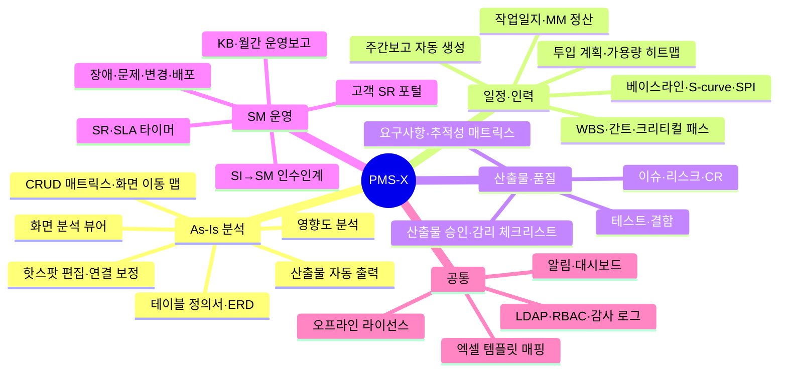

| 영역 | 주요 화면 | 한 줄 설명 |
|---|---|---|
| **As-Is 분석** | 화면 분석 뷰어, 분석 진척, 테이블 정의서, ERD, CRUD, 이동 맵, 영향도, 산출물 출력 | 레거시를 화면 단위로 해부하고 분석 업무 자체를 관리 |
| **일정** | WBS/간트, 칸반, 베이스라인, 주간보고 | 영업일 CPM 크리티컬 패스, 진척 롤업, 고객사 양식 보고서 |
| **인력·공수** | 인력 풀, 투입 계획·히트맵, 작업 배분, 작업일지, MM 정산 | 과배정 경고, 작업일지 승인 → 실적 MM |
| **산출물·추적성** | 산출물 대장, 요구사항, 추적성 매트릭스, 감리 체크리스트 | 요구사항 ↔ 화면·버튼 ↔ 테스트 ↔ 결함 ↔ CR ↔ SR |
| **품질** | 이슈, 리스크(5×5), CR, 테스트, 결함, 회의록 | 핫스팟에서 바로 결함 등록 |
| **SM 운영** | SR, 장애, 문제, 변경·배포, 정기 작업, 운영 자산, KB, SLA, 월간 운영보고, 고객 포털 | 업무시간·공휴일 SLA, 유사 SR/KB 추천 |
| **관리** | 사용자·역할, 공통코드, 방법론, 엑셀 템플릿, 감사 로그, 라이선스 | LDAP/AD, 5회 실패 잠금, Ed25519 오프라인 라이선스 |

---

## 3. As-Is 화면 분석은 어떻게 동작하나

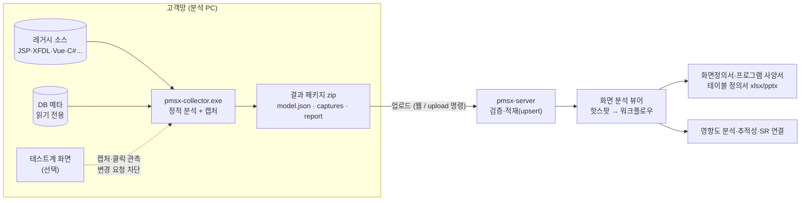

### 3.1 버튼 하나의 워크플로우

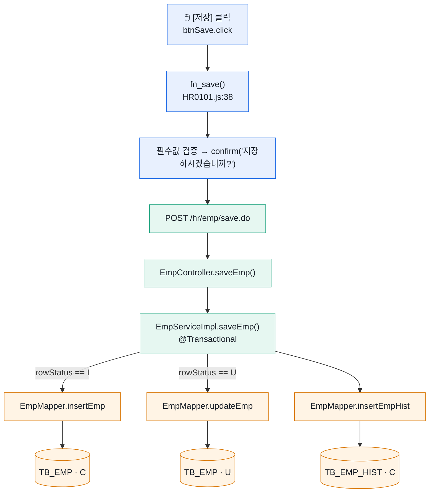

모든 연결선에는 **출처(정적 / 동적 / 수동)와 신뢰도**가 붙는다. 테스트계에서 실제로 관측한 요청은 동적(100%), 소스만으로 찾은 것은 정적, 분석자가 고친 것은 수동이며 **재수집해도 수동 보정은 유지**된다.

### 3.2 지원 기술

| 화면 기술 | 서버·데이터 | 화면 그림 |
|---|---|---|
| JSP + jQuery | Spring (MyBatis·iBatis, 필드·생성자 주입) | 실제 캡처 · **정적 렌더링**(서버 없이 JSP→HTML) |
| Struts 1 + 자체 프레임워크 | Action·DispatchAction·Worker류 + 쿼리 XML | 실제 캡처 · 정적 렌더링 |
| Nexacro N/14/17 · XPlatform · MiPlatform | transaction → 서버 매핑 | 소스 좌표 **와이어프레임** |
| WebSquare 5 | submission → 서버 매핑 | 와이어프레임 |
| Vue 2/3 · React | 라우터·axios/fetch → REST | 실제 캡처(SPA 라우트 순회) |
| WinForms | C# → ADO.NET·Dapper·EF·SP | **데스크톱 캡처**(UI Automation) · 와이어프레임 |
| ASP.NET WebForms · MVC | 코드비하인드·Controller | 실제 캡처 |
| DB 메타 | Oracle · Tibero · PostgreSQL · MSSQL · MySQL/MariaDB | — |

> FK 가 없는 레거시 DB 도 **SQL 의 JOIN 패턴으로 테이블 관계를 추정**해 ERD 에 점선으로 그리고, 분석자가 확정/기각한다.

---

## 4. 아키텍처

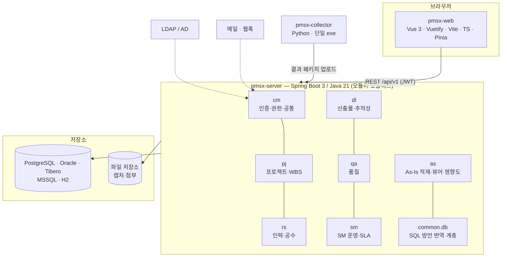

| 구성 | 기술 | 비고 |
|---|---|---|
| 웹 | Vue 3, Vuetify 3, Vite, TypeScript, Pinia, ECharts, Vue Flow + elkjs | Pretendard 로컬 번들, 외부 CDN 0건, 라이트/다크 |
| 서버 | Spring Boot 3, Java 21, JdbcTemplate, Flyway(벤더별), Apache POI | 웹 정적 리소스 포함 **단일 jar** |
| DB | PostgreSQL · H2 · Oracle 12c+ · Tibero · SQL Server 2016+ | 실행 직전 SQL 방언 번역 (`kr.pmsx.common.db`) |
| 수집기 | Python 3.13, tree-sitter, sqlglot, Playwright(설치된 Chrome/Edge), pywinauto | PyInstaller 단일 exe(약 70MB) |
| 배포 | jlink JRE 21 + 시작/중지 스크립트 + nginx 예시 + Docker 예시 | 오프라인 라이선스(Ed25519) |

### SI 에서 SM 으로 — 자산이 이어지는 구조

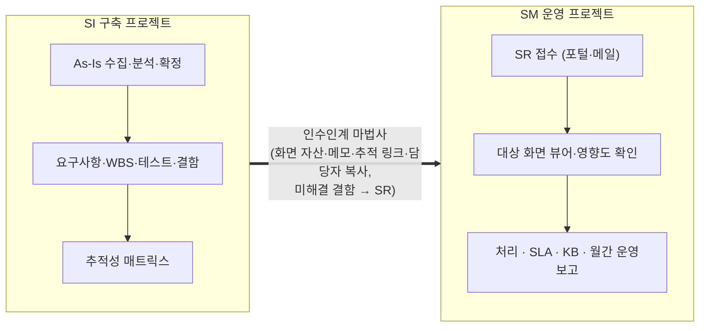

---

## 5. 화면 둘러보기

<table>
<tr>
<td width="50%">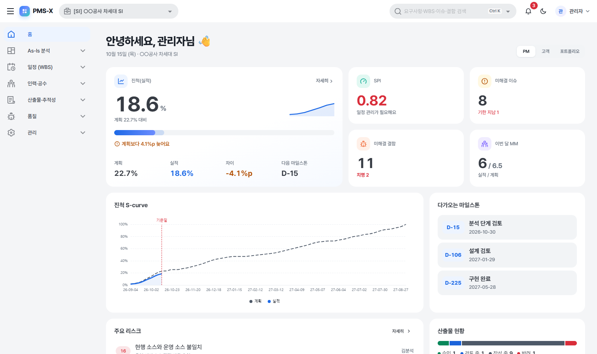<br/><b>홈 대시보드</b> — 벤토 타일로 진척·SPI·이슈·결함·MM·마일스톤</td>
<td width="50%">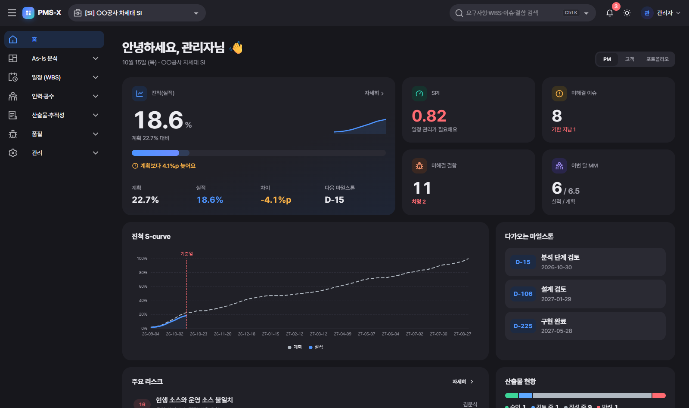<br/><b>다크 모드</b> — 같은 톤의 차콜 테마</td>
</tr>
<tr>
<td>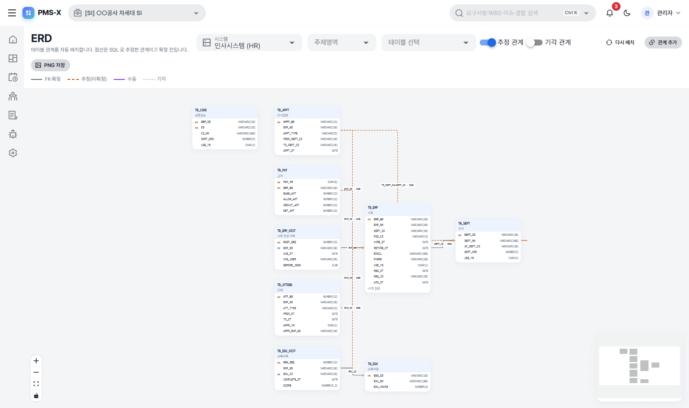<br/><b>ERD</b> — 자동 배치, FK 실선·추정 관계 점선(신뢰도)</td>
<td>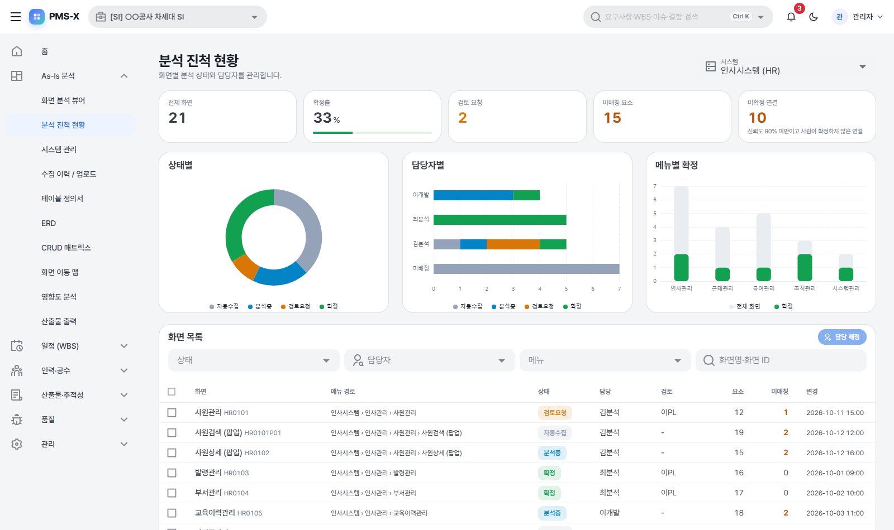<br/><b>분석 진척</b> — 상태·담당자·메뉴별, 일괄 배정</td>
</tr>
<tr>
<td>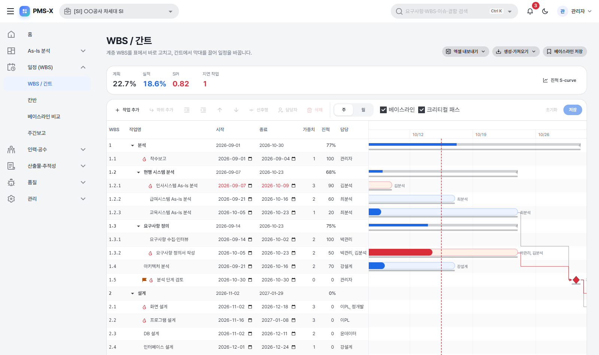<br/><b>WBS / 간트</b> — 드래그 일정 변경, 크리티컬 패스, 베이스라인</td>
<td>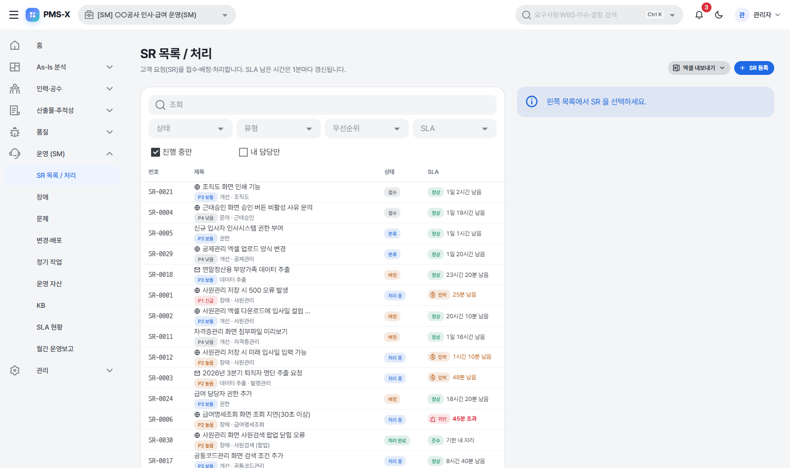<br/><b>SR 처리</b> — SLA 남은 시간, 대상 화면 뷰어 바로가기</td>
</tr>
<tr>
<td>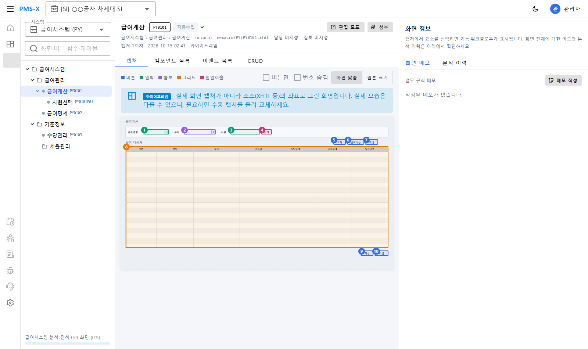<br/><b>와이어프레임</b> — Nexacro 런타임 없이 소스 좌표로 그린 화면</td>
<td>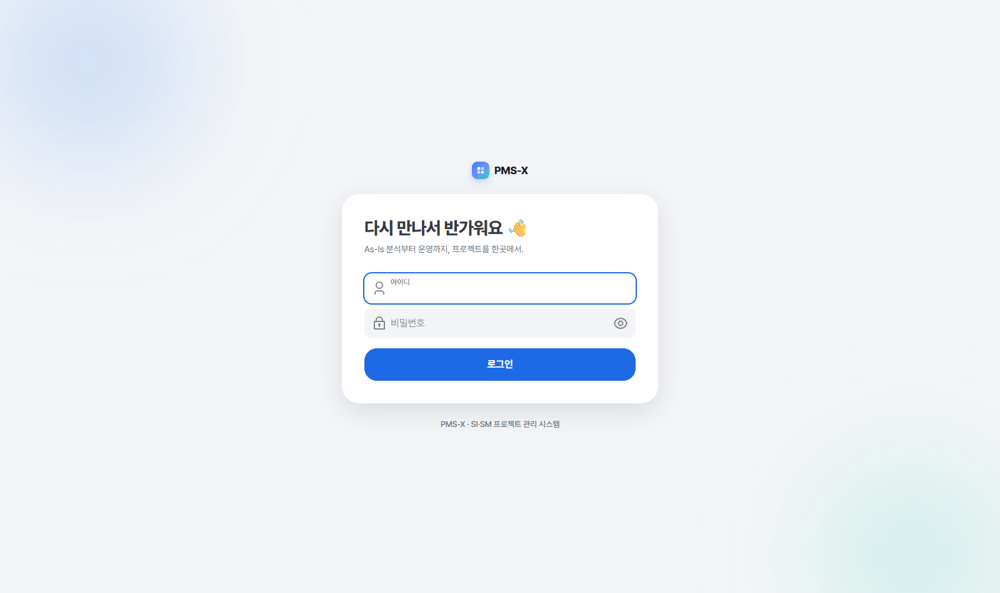<br/><b>로그인</b></td>
</tr>
</table>

---

## 6. 빠른 시작

### 6.1 시연용 (설치 패키지)

```powershell
# 1) 오프라인 설치 패키지 빌드 (웹 빌드 → 서버 jar 포함 → jlink JRE → zip)
powershell -ExecutionPolicy Bypass -File deploy\build-offline.ps1
#    → deploy\out\pmsx-<버전>-offline.zip

# 2) 압축 해제 후 시연 모드 실행 (샘플 시스템 3종 + SM 프로젝트 + SR 데모 데이터)
pmsx-<버전>\bin\start-demo.bat          # http://localhost:8080
```

| 계정 | 비밀번호 | 역할 |
|---|---|---|
| `admin` | `pmsx1234!` | 관리자 + PM |
| `analyst` | `pmsx1234!` | 분석자 |
| `customer` | `pmsx1234!` | 고객 (SR 포털) |

> 운영 설치는 `bin\start.bat`(prod 프로필 — 시드 없음, 최초 관리자 비밀번호 `run/initial-admin-password.txt`, 라이선스 키 필요). 자세한 내용은 [`deploy/README.md`](deploy/README.md) 와 패키지의 `docs/설치가이드.md`.

### 6.2 개발 모드

```bash
# 서버 (JDK 21 은 Gradle 툴체인이 ~/.gradle/jdks 에 자동 내려받음)
cd pmsx-server && ./gradlew bootRun                 # :8080, local 프로필(H2 + 데모 데이터)

# 웹
cd pmsx-web && npm install && npm run dev           # :5173 → /api 프록시
npm run dev:mock                                    # 서버 없이 mock 데이터로

# 수집기 (샘플 레거시 수집 → zip)
cd pmsx-collector
python -m venv .venv && .venv/Scripts/python -m pip install -r requirements-dev.txt
python ../samples/hr-legacy/mock_server.py          # 캡처용 샘플 레거시 (:8091)
.venv/Scripts/python -m pmsx_collector run -c ../samples/hr-legacy/collector.yaml
```

### 6.3 저장소 DB 선택

| DB | 프로필 | 비고 |
|---|---|---|
| H2 | `local` / `demo` | 개발·시연 |
| PostgreSQL | `postgres` | 권장 운영 DB |
| Oracle 12c+ | `oracle` | AL32UTF8 |
| Tibero 6/7 | `tibero` | 고객사 Tibero JDBC jar 를 `lib/` 에 |
| SQL Server 2016+ | `mssql` | 대소문자 구분 정렬(`_CS_`) 필요 |

---

## 7. 새 시스템 As-Is 추가하기

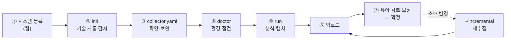

```bat
pmsx-collector.exe init D:\src\hr-web --code HR --name 인사시스템   :: 설정 초안 (근거 주석 포함)
pmsx-collector.exe doctor -c collector.yaml                         :: 브라우저·DB·URL·글꼴 점검
pmsx-collector.exe run -c collector.yaml                            :: 결과 패키지 out\pmsx-HR-*.zip
pmsx-collector.exe upload -c collector.yaml --server https://pmsx.local --user analyst
```

테스트 서버가 없어도 된다 — HTML 계열 화면은 **정적 렌더링**, Nexacro·WebSquare·WinForms 는 **와이어프레임**으로 화면 그림을 만든다.
단계별 설정·화면 그림 선택 기준·문제 해결은 **[새 시스템 As-Is 추가 매뉴얼](docs/16_신규시스템_AsIs추가_매뉴얼.md)** 참고.

> 실적: 실제 운영 중인 Struts 1 + 자체 프레임워크 시스템(화면 약 1,800개)을 테스트 서버 없이 분석 — 정적 분석 4분, 정적 렌더링 10분(화면 96% 렌더), 서버로 요청하는 버튼의 SQL 도달률 83%.

---

## 8. 저장소 구조

```
pmsx/
├── pmsx-web/          Vue 3 + Vuetify 웹 (src/pages · components · api · stores · mocks)
├── pmsx-server/       Spring Boot 3 서버 (kr.pmsx.{common,cm,pj,rs,dl,qa,sm,as}, Flyway 벤더별 마이그레이션)
├── pmsx-collector/    As-Is 수집기 (parsers/ · render/ · capture · desktop_capture · merge · package)
├── samples/           수집기 검증용 가상 레거시 8종
│   ├── hr-legacy        JSP + jQuery / Spring + MyBatis (캡처용 mock 서버 포함)
│   ├── hr-struts        Struts 1 + 자체 프레임워크 + 쿼리 XML (EUC-KR)
│   ├── hr-nexacro       Nexacro XFDL
│   ├── hr-spa           Vue 3 + React
│   ├── hr-websquare     WebSquare 화면 XML
│   ├── hr-xplatform     XPlatform · MiPlatform
│   ├── hr-winforms      .NET 7 WinForms (빌드·데스크톱 캡처 가능)
│   └── hr-aspnet        ASP.NET WebForms · MVC
├── deploy/            오프라인 설치 패키지 빌드 스크립트·템플릿·라이선스 도구
└── docs/              기획·설계·API 명세·결과 보고·매뉴얼 (+ img/, mockup/, schema/)
```

---

## 9. 문서

| # | 문서 | 내용 |
|---|---|---|
| 01 | [요구사항 정의서](docs/01_요구사항정의서.md) | 기능(FR-*)·비기능(NFR-*) 요구사항 |
| 02 | [메뉴 구조·화면 목록](docs/02_메뉴구조_화면목록.md) | IA, 화면 ID |
| 03 | [As-Is 뷰어 화면 설계](docs/03_AsIs뷰어_화면설계.md) | 시그니처 화면 설계 + [클릭 목업](docs/mockup/asis-viewer.html) |
| 04 | [수집기 설계·중간모델](docs/04_수집기설계_중간모델.md) | 파이프라인·파서·[JSON 스키마](docs/schema/asis-model.schema.json) |
| 05 | [데이터 모델(ERD)](docs/05_데이터모델_ERD.md) | 핵심 엔터티·릴리스별 변경 |
| 06 | [권한 매트릭스](docs/06_권한매트릭스.md) | 역할 × 기능 |
| 07 | [WBS](docs/07_WBS.md) | 릴리스별 작업 분해 |
| 08·10~13 | API 명세 [R0](docs/08_API명세_R0.md) · [공통](docs/10_API명세_R0후반_공통.md) · [R1](docs/11_API명세_R1_AsIs.md) · [R2](docs/12_API명세_R2_일정인력품질.md) · [R3](docs/13_API명세_R3_SM운영.md) | server ↔ web ↔ collector 계약 |
| 09 | [R0 구현 계획](docs/09_R0_구현계획.md) | 뷰어 PoC |
| 14 | [개발 결과 보고](docs/14_개발결과보고.md) | 릴리스별 결과·검증·한계 |
| 15 | [사용자 가이드](docs/15_사용자가이드.md) | 역할별 사용법 |
| 16 | [새 시스템 As-Is 추가 매뉴얼](docs/16_신규시스템_AsIs추가_매뉴얼.md) | 수집 절차·설정·문제 해결 |

모듈별 상세: [`pmsx-collector/README.md`](pmsx-collector/README.md) · [`pmsx-server/README.md`](pmsx-server/README.md) · [`pmsx-web/README.md`](pmsx-web/README.md) · [`deploy/README.md`](deploy/README.md)

---

## 10. 품질·검증

| 대상 | 결과 |
|---|---|
| 수집기 `pytest` | 91건 통과 (Chrome 캡처·데스크톱 캡처·정적 렌더링 통합 테스트 포함) |
| 서버 `./gradlew test` | 218건 통과 (H2 · 내장 PostgreSQL · Oracle/MSSQL 호환 모드) |
| 웹 `vitest` · `eslint` · `vue-tsc` | 93건 통과 · 0건 · 통과 |
| SQL Server 실DB | 테스트 SQL 19,265건 재생 오류 0건 |
| 성능 (화면 5,000 · 엣지 115만) | 화면 상세 ≤ 105ms · 워크플로우 ≤ 84ms · 검색 ≤ 869ms |
| 통합 | 설치 패키지 기동 + 브라우저로 화면 53개 + 고객 포털 순회 — API·콘솔 오류 0건 |
| 수집 안전성 | 모든 샘플 캡처에서 서버에 도달한 변경 요청 0건 |

---

## 11. 로드맵

- [x] R0 화면 분석 뷰어 PoC · 오프라인 설치 패키지 · 공통 기능
- [x] R1 As-Is 고도화 (편집·ERD·진척·산출물) · Nexacro / Vue / React
- [x] R2 일정·인력·산출물·품질 · 대시보드·알림
- [x] R3 SM 운영 · 고객 포털 · 영향도 분석 · SI→SM 인수인계 · WebSquare / XPlatform / WinForms / ASP.NET
- [x] 멀티 DB (Oracle · Tibero · MSSQL) · 디자인 개편 · Struts 1 · JSP 정적 렌더링
- [ ] Oracle · Tibero **실DB** 검증
- [ ] 폐쇄망 AI (로컬 LLM) — 함수·버튼 설명 초안, SR 분류·담당자 추천, 자연어 질의
- [ ] EVM 원가 지표(CPI), Git/Jenkins 배포 연계, 캡처 개인정보 마스킹 편집기

---

<div align="center">
<sub>사내 개발 표준(AI 하네스)을 따라 개발되었으며, 하네스 규칙 파일은 공개 저장소에 포함하지 않는다.</sub>
</div>
