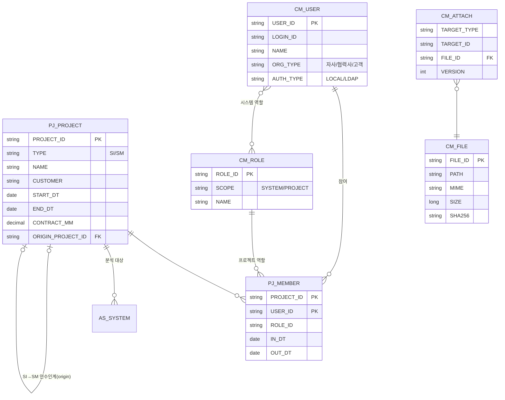
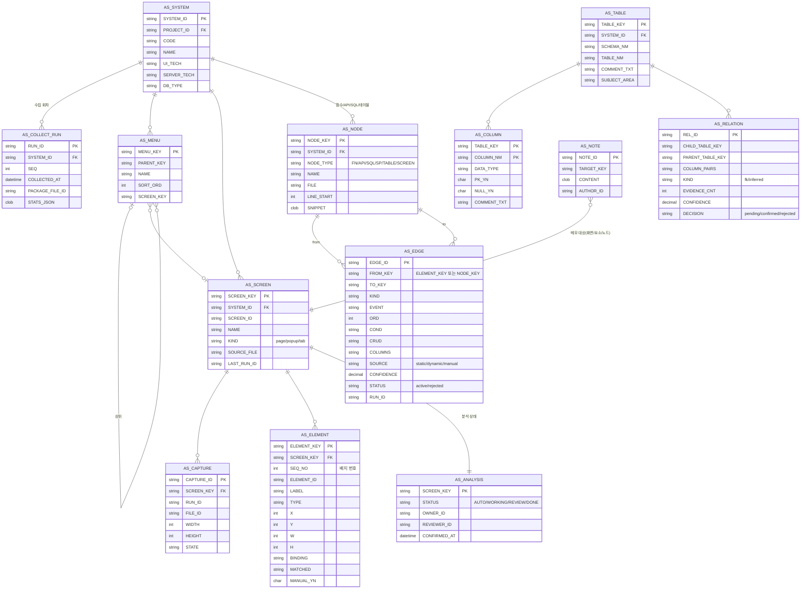
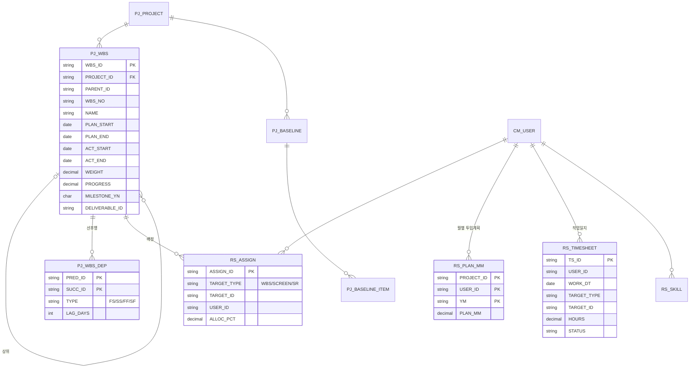
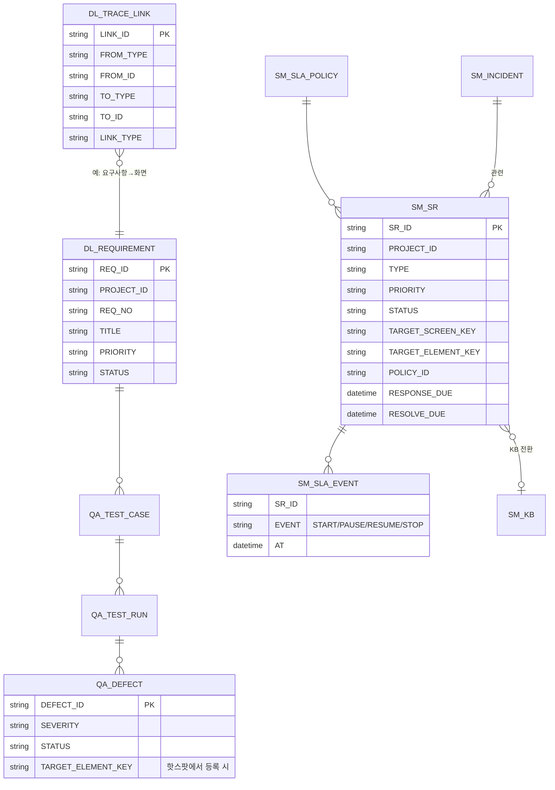

# 05. 데이터 모델 (핵심 ERD)

- 문서 버전: v0.1 (2026-10-14) — 논리 모델 초안. 물리 컬럼·인덱스는 R0/R1 착수 시 확정.
- 테이블 접두어 = 모듈 코드: `CM_` 공통 · `PJ_` 프로젝트 · `RS_` 인력 · `AS_` As-Is · `DL_` 산출물·추적성 · `QA_` 품질 · `SM_` 운영
- 공통 컬럼(모든 테이블): `CREATED_AT, CREATED_BY, UPDATED_AT, UPDATED_BY` (표에서는 생략)
- 멀티 DB(PostgreSQL·Oracle·Tibero·MSSQL) 호환: 표준 타입만 사용, 시퀀스 대신 앱에서 ID 생성(ULID/Snowflake), JSON은 CLOB/TEXT로 저장.

## 1. 공통·프로젝트

## 2. As-Is 화면 분석 (핵심)

**설계 포인트**
- 수집 결과의 안정 키(`scr:`, `el:`, `fn:` …)는 시스템 안에서만 유일하므로, 물리 PK는 **대리 ID(ULID)** 로 두고 `(SYSTEM_ID, KEY)` 유니크 제약을 건다 (위 그림의 `*_KEY PK` 표기는 논리 식별자). 재수집 시 키 기준 upsert, 수동 보정(`MANUAL_YN='Y'`, `SOURCE='manual'`)은 덮어쓰지 않음. → [08 API 명세](08_API명세_R0.md) §0
- 재수집에서 사라진 객체는 삭제하지 않고 `LAST_RUN_ID`가 갱신되지 않은 것으로 판별 → 회차 비교(FR-AS-024).
- 워크플로우 조회 = `AS_EDGE` 재귀 탐색 (PostgreSQL/Oracle 모두 재귀 CTE 지원). 깊이 제한·공통 함수 접기는 앱에서 처리.
- 대규모(연결선 100만 건) 대비: `AS_EDGE(FROM_KEY)`, `AS_EDGE(TO_KEY)` 인덱스, 시스템 단위 파티셔닝 검토.

## 3. 일정·인력

- `RS_ASSIGN`·`RS_TIMESHEET`의 `TARGET_TYPE`으로 WBS 태스크·화면 분석(`AS_SCREEN`)·SR을 같은 구조로 배정·공수 집계.

## 4. 품질·추적성·운영

- 이슈·리스크·CR·회의록·장애·변경·운영자산·KB 등 나머지 테이블은 일반 대장 구조로 R2/R3 상세 설계에서 추가.
- **`DL_TRACE_LINK`가 추적성의 단일 근간**: `FROM_TYPE/TO_TYPE` ∈ {REQ, SCREEN, ELEMENT, NODE, TABLE, TC, DEFECT, CR, SR, RELEASE}. 영향도 분석(FR-AS-028)은 `AS_EDGE`(코드 연결) + `DL_TRACE_LINK`(업무 연결)를 합쳐 탐색.

## 5. 구현 반영 내역 (물리 모델 변경 이력)

| 릴리스 | 추가/변경 | 비고 |
|---|---|---|
| R0 | `AS_EDGE.MODEL_SEQ` | 수집 결과 내 순서 보존(워크플로우 단계 정렬) |
| R0 후반 | `CM_PASSWORD_HISTORY`, `CM_CODE_GROUP`, `CM_CODE`, `CM_TERM`, `CM_ATTACH`, `CM_ATTACH_VERSION`, `CM_EXCEL_TEMPLATE`, `CM_AUDIT_LOG`(LOG_AT·PROJECT_ID), `CM_LICENSE` | 공통 기능 (10 명세) |
| R0 후반 | `CM_USER` + `EMAIL, LOCKED, FAIL_COUNT, LAST_LOGIN_AT, PASSWORD_CHANGED_AT` / `AS_CAPTURE` + `SCALE` | 비밀번호 정책·잠금, 스키마 v0.2 |
| R1 | `AS_ANALYSIS_HIST` | 분석 상태 변경 이력 |
| R1 | `AS_ELEMENT` + `HIDDEN, ORIGIN, UPDATED_AT/BY` · `AS_NODE` + `MANUAL_YN` · `AS_EDGE` + `CONFIRMED, EDITED, UPDATED_AT/BY` · `AS_CAPTURE` + `MANUAL, UPLOADED_BY, STATE`(RUN_ID NULL 허용) · `AS_NOTE` + `TARGET_TYPE, TARGET_ID, UPDATED_AT` · `AS_TABLE` + `COMMENT_MANUAL` · `AS_RELATION` + `CREATED_BY, UPDATED_AT/BY`(KIND manual) · `AS_COLLECT_RUN` + `DIFF_DETAIL_JSON` | 핫스팟 편집·수동 보정 보존·회차 diff (조회 인덱스 8개 추가) |
| R1 | Flyway 폴더 `db/migration/{common,h2,postgresql,oracle,sqlserver}` | 벤더별 마이그레이션 분리 (Oracle·MSSQL은 방언 계층 미구현으로 기동 차단) |
| R2 | PJ: `PJ_METHODOLOGY, PJ_SEQ, PJ_MEMBER_SCOPE, PJ_MEMBER_CHECK, PJ_WBS, PJ_WBS_DEP, PJ_BASELINE, PJ_BASELINE_ITEM, PJ_WEEKLY_REPORT` · RS: `RS_SKILL, RS_MM_PLAN, RS_ASSIGN, RS_TIMESHEET, RS_TIMESHEET_ENTRY` · DL: `DL_DELIVERABLE, DL_REQUIREMENT, DL_REQUIREMENT_HIST, DL_TRACE_LINK, DL_AUDIT_CHECK` · QA: `QA_ISSUE, QA_COMMENT, QA_RISK, QA_DECISION, QA_CR, QA_TEST_SCENARIO, QA_TEST_CASE, QA_TEST_ROUND, QA_TEST_RESULT, QA_DEFECT, QA_MEETING, QA_ACTION_ITEM` · CM: `CM_STATUS_HIST, CM_NOTIFICATION, CM_NOTIFY_SETTING` | 12 명세. `CM_USER` + `GRADE, COMPANY, PHONE`, `PJ_PROJECT` + `METHODOLOGY_ID`. 코드 그룹 `HOLIDAY, ONBOARD_ITEM, AUDIT_ITEM` (V4__r2_pm.sql) |
| R3 | `SM_SLA_POLICY, SM_SR, SM_SLA_EVENT, SM_SR_COMMENT, SM_INCIDENT, SM_INCIDENT_TIMELINE, SM_PROBLEM, SM_CHANGE, SM_CHANGE_CAB, SM_ROUTINE_JOB, SM_ROUTINE_CHECK, SM_OPS_ASSET, SM_KB, SM_MONTHLY_REPORT` | 13 명세 (V5__r3_sm.sql). 인덱스 `IX_AS_ANALYSIS_STATUS`, `IX_AS_ELEMENT_SYSTEM_SCREEN`. 인수인계 복사본 ID = 새 10자 접두어 + 원본 ULID 뒤 16자 |

실제 DDL의 기준은 `pmsx-server/src/main/resources/db/migration` (Flyway)이다.
