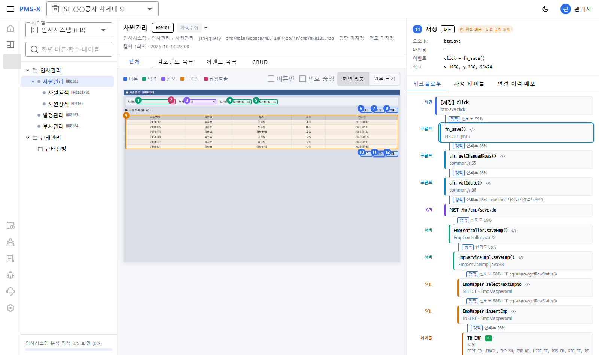

# 09. R0 구현 계획 (Implementation Plan) — 뷰어 PoC 수직 슬라이스

> 회사 표준 `.skills/rules/implementation-plan` 양식. 상태: `[ ]` TODO · `[-]` 진행 · `[x]` 완료 · `[!]` 막힘

## 1. 📝 작업 요약
- **작업 목표:** 샘플 레거시(JSP+jQuery / Spring+MyBatis)를 수집기로 분석·캡처 → 결과 패키지를 서버에 업로드 → 웹 As-Is 뷰어에서 버튼 클릭 시 함수→API→SQL→테이블 워크플로우 표시까지 **끝에서 끝까지** 동작.
- **관련 문서:** 03 뷰어 설계, 04 수집기 설계, 05 ERD, 08 API 명세, 목업 `docs/mockup/asis-viewer.html`
- **범위 밖(R0 후반/R1):** 오프라인 설치 패키지, LDAP, 엑셀 엔진, 핫스팟 편집기, Nexacro·Vue 파서

## 2. 🔍 사전 확인 사항
- [x] 디자인 시안 — 목업 HTML (사용자 확인 완료)
- [x] API 명세 — `08_API명세_R0.md`
- [x] 중간모델 스키마 — `schema/asis-model.schema.json`
- [x] 개발 환경 — Node 24 / npm 11, Python 3.13 + Playwright(설치된 Chrome 사용), **JDK는 11만 설치됨** → Gradle 툴체인으로 JDK 21 자동 내려받기
- [ ] 실제 고객사 레거시 샘플 — 미확보, 자체 제작 샘플(`samples/hr-legacy`)로 대체

## 3. 🏃 단계별 계획

- **Phase 1: 샘플 레거시 + 수집기** (`samples/hr-legacy`, `pmsx-collector`)
  - [x] 샘플: 화면 3~4개(사원관리·사원검색 팝업·발령관리 등), JS, Controller/Service/Mapper, MyBatis XML, DDL, 메뉴 데이터, 캡처용 mock 서버
  - [x] 수집기: 설정 YAML, 파서(jsp-jquery·spring·mybatis·sql·ddl), Playwright 캡처(요청 가로채기·차단·위험 버튼 제외), 병합·매칭, 패키지·리포트
  - [x] 테스트: pytest, 결과 `model.json` 스키마 통과

- **Phase 2: 서버** (`pmsx-server`)
  - [x] Gradle 래퍼 + JDK 21 툴체인, Spring Boot 3, H2(로컬)·PostgreSQL 프로필, Flyway
  - [x] 인증(JWT + refresh 쿠키), 시드(사용자·프로젝트)
  - [x] 패키지 업로드·검증·upsert 적재, 뷰어 조회 API(08 명세 §2~4)
  - [x] 테스트: 픽스처 패키지 적재 → 워크플로우 API 검증

- **Phase 3: 웹** (`pmsx-web`)
  - [x] Vue 3 + Vuetify + Vite + TS + Pinia, 회사 `.skills` 규칙 적용
  - [x] 로그인, 레이아웃(GNB/LNB), 시스템·업로드 화면(SCR-AS-003/004), **As-Is 뷰어(SCR-AS-001)**
  - [x] 서버 없이도 확인 가능한 mock 모드(`VITE_USE_MOCK=true`)

- **Phase 4: 통합**
  - [x] 샘플 수집 → 업로드 → 뷰어 확인 (스크린샷)

## 4. ✅ 최종 검증
- [x] `pytest` (collector), `./gradlew test` (server), `npm run build` (web) 통과
- [x] 끝에서 끝까지: 저장 버튼 워크플로우가 `fn_save → POST /hr/emp/save.do → EmpController.saveEmp → … → TB_EMP(C/U)` 로 표시
- [x] 수집 중 변경성 요청이 차단되어 리포트에 기록됨
- [x] 데스크톱·모바일 폭 화면 확인, 콘솔 에러 없음

## 5. 결과 (2026-10-14)
- 통합 확인 화면: 
- 샘플 수집 지표: 화면 5 · 요소 33(매칭 100%) · 버튼 핸들러 16/17 · 엣지 141(동적 11) · 추정 관계 7 · 차단 요청 1 · 소요 25초
- 테스트: collector pytest 13 · server 10 · web vitest 8 — 모두 통과

## 6. 남은 작업 (R0 후반 → R1)
- [ ] 오프라인 설치 패키지(Docker tar / jar+nginx), 라이선스 키, LDAP
- [ ] 공통코드·첨부·엑셀 엔진(FR-CM-004~006), 간트 라이브러리 PoC
- [ ] 스키마 v0.2: `sqlStatements.namespace` 추가(동명 Mapper 키 충돌), 화면 로드 이벤트(`scr:` → `event`) 명시, SQL→SP `calls` 명시, `captures[].scale`, 항목 `additionalProperties:false`
- [ ] 수집기 한계 보완: JS 함수 표현식·객체 메서드, `#id` 외 선택자, 생성자 주입·iBatis DAO, 더블클릭 등 클릭 외 이벤트, 화면 재로딩 최소화
- [ ] 서버: 적재 실패 시 고아 파일 정리, refresh 토큰 정리 배치, PostgreSQL 실DB 검증
- [ ] 웹: 프레임워크 버전 표준 갱신(Vite 5·vue-i18n 9·unplugin-vue-router — 사내 표준 개정과 함께), ESLint, 접근 로그 API
- [ ] 실제 고객사 레거시로 수집 지표 측정 (R1 완료 기준)
