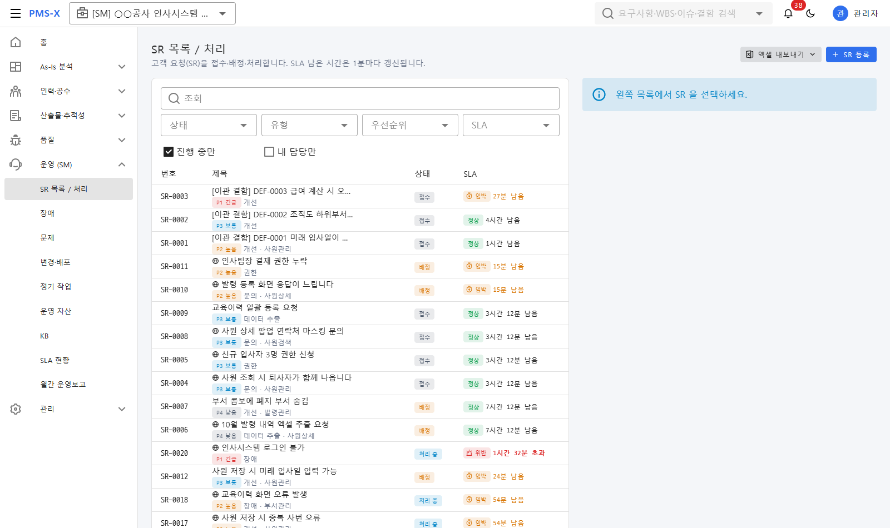

# 14. 개발 결과 보고 (R0 ~ R3)

- 문서 버전: v1.1 (2026-10-15) — 1.1.0: 멀티 DB(Oracle·Tibero·MSSQL), 디자인 개편(클린 벤토)
- 범위: 기획안(R0~R3) 전체 구현 + R4 일부(수집기 편의 기능). 기준 산출물: `deploy/out/pmsx-1.0.0-offline.zip`

## 1. 한눈에 보기

| 릴리스 | 내용 | 상태 |
|---|---|---|
| R0 | 뷰어 PoC: 샘플 수집 → 업로드 → 버튼 워크플로우 | 완료 |
| R0 후반 | 공통코드·첨부·엑셀 엔진·사용자/권한·LDAP·감사 로그·라이선스·**폐쇄망 설치 패키지** | 완료 |
| R1 | As-Is 웹 1차: 핫스팟 편집·연결 보정·메모·분석 진척·테이블 정의서·ERD·CRUD·화면 이동 맵·산출물 출력, Nexacro·Vue/React 분석 | 완료 |
| R2 | WBS/간트(CPM·베이스라인)·주간보고·인력/MM/작업일지·산출물/요구사항/추적성·이슈/리스크/CR/테스트/결함·대시보드·알림 | 완료 |
| R3 | SR·SLA·고객 포털·장애/문제/변경·정기 작업·운영 자산·KB·월간 운영보고·**SI→SM 인수인계**·**영향도 분석**, WebSquare·XPlatform/MiPlatform·WinForms·ASP.NET 분석 | 완료 |
| R4 | 수집기 증분 수집·init·doctor·upload | 일부 완료 (AI·EVM·Git 연계 미착수) |

## 2. 모듈별 결과

### 2.1 수집기 `pmsx-collector` (Python, 단일 exe 약 70MB)
- 화면 기술 9종: JSP/jQuery, Nexacro, XPlatform, MiPlatform, WebSquare, Vue, React, WinForms, ASP.NET(WebForms/MVC)
- 서버 기술 추가(1.1): **Struts 1 + 자체 프레임워크**(Worker류 Action·서비스 빈·쿼리 XML 규칙을 설정으로), **JSP 정적 렌더링**(서버 없이 JSP→HTML→스크린샷+핫스팟)
- 실제 운영 소스 파일럿(Struts 1 LMS, 화면 1,814): 정적 분석 4분 25초, 정적 렌더 1,744화면(96%)·요소 좌표 77%, 서버 요청 버튼의 SQL 도달 83% — 상세 결과는 고객 소스가 포함되어 저장소 밖에 보관
- 서버: Spring(MyBatis·iBatis, 필드·생성자 주입), .NET(ADO.NET·Dapper·EF), SP(PL/SQL·T-SQL)
- DB 메타: Oracle·Tibero·PostgreSQL·MSSQL·MySQL (읽기 전용 질의만)
- 캡처: 웹(Playwright, 변경 요청 차단·위험 버튼 제외), 데스크톱(Windows UI Automation), 런타임 없는 화면은 소스 좌표 와이어프레임
- 현장 도구: `init`(기술 자동 감지·설정 생성), `doctor`(환경 점검), `--incremental`(30초 → 8초), `upload`
- 샘플 7종 지표

| 샘플 | 화면 | 요소 | 버튼 핸들러 연결 | 엣지 |
|---|---|---|---|---|
| hr-legacy (JSP) | 6 | 42 | 21/22 | 187 |
| hr-nexacro | 4 | 31 | 16/17 | 144 |
| hr-spa (Vue+React) | 6 | 33 | 16/17 | 133 |
| hr-winforms (실제 창 캡처) | 5 | 32 | 17/18 | 94 |
| hr-websquare | 3 | 23 | 12/13 | 88 |
| hr-xplatform (XP+MI) | 3 | 20 | 10/10 | 77 |
| hr-aspnet | 4 | 24 | 9/12 | 85 |

### 2.2 서버 `pmsx-server` (Spring Boot 3 / Java 21)
- 패키지: `common, cm, pj, rs, dl, qa, sm, as` (모듈러 모놀리스), JdbcTemplate, Flyway(V1~V5, 벤더 폴더)
- DB: H2(기본)·PostgreSQL·**Oracle·Tibero·MSSQL**(1.1.0, `kr.pmsx.common.db` 방언 번역 계층 — 실행 직전 SQL 변환). 테스트 218건
- 성능(화면 5,000·요소 20만·엣지 115만): 화면 상세 ≤ 105ms, 워크플로우 ≤ 84ms, 검색 ≤ 869ms, 시스템 CRUD ≈ 1초, 진척 집계 ≤ 117ms

### 2.3 웹 `pmsx-web` (Vue 3 + Vuetify + Vite + TS)
- 화면 약 55개 + 고객 포털, **1.1.0 디자인 개편: 토스·노션풍 클린 벤토**(Pretendard 로컬 번들, 파스텔 블루·민트, 라운드 카드, 벤토 홈 대시보드, Ctrl+K 검색), 회사 `.skills` 규칙 준수(api-standard, security-frontend 등), ESLint 0건
- 외부 CDN·웹폰트 없음(폐쇄망), 아이콘 필요분만 번들, 차트·ERD·elk는 지연 로딩
- 간트는 외부 라이브러리 없이 SVG 자체 구현(상용 라이선스 회피)

### 2.4 설치 패키지 `deploy`
- 단일 jar(웹 포함) + jlink JRE 21 + 시작/중지 스크립트 + 설정 템플릿 + nginx 예시 + Docker(미검증) + 라이선스 발급 도구
- 오프라인 라이선스(Ed25519), prod 첫 기동 시 관리자 비밀번호 자동 생성, JWT 키 자동 생성

## 3. 검증

| 구분 | 결과 |
|---|---|
| 수집기 pytest | 91건 통과 (Struts 1·정적 렌더링 포함) |
| 서버 `./gradlew test` | 218건 통과 (H2 + 내장 PostgreSQL + Oracle/MSSQL 호환 모드) |
| 웹 vitest / lint / build | 93건 통과 / 0건 / 성공 (라이트·다크 50화면 점검) |
| 통합(설치 패키지 기동 + 브라우저) | 단계별 수행: R0·R0 후반·R1·R2·R3. 최종 0.5.0 기준 화면 55개 + 고객 포털에서 API 오류 0건 |
| 쓰기 차단 | 모든 샘플 수집에서 mock 서버 도달 쓰기 요청 0건 |

> 최종 1.0.0 패키지 수치는 아래 §6에 갱신.

## 4. 요구사항 대비 미구현·부분 구현

| 항목 | 상태 | 비고 |
|---|---|---|
| FR-AI-001~005 (폐쇄망 AI) | 미착수 | R4. LLM 게이트웨이·함수 설명 초안·SR 분류 추천 |
| FR-PJ-010 EVM | 부분 | SPI·S-curve는 있음, CPI(AC 원가) 없음 |
| FR-SM-008 Git/Jenkins 연계 | 부분 | 변경에 커밋 수기 입력만 |
| NFR-ENV-003 Oracle·Tibero·MSSQL | 1.1.0 지원 | SQL 방언 번역 계층 + 벤더별 DDL. MSSQL은 실DB(SQLEXPRESS)에서 SQL 19,265건 재생 오류 0, Oracle·Tibero는 H2 호환 모드·정적 검사만(실DB 미검증). Tibero JDBC는 `lib/`에 고객사 제공 jar |
| NFR-SEC-004 캡처 개인정보 마스킹 | 부분 | 수집 시 selector 블러만, 뷰어에서 영역 지정 편집 없음 |
| 다국어 | 부분 | 한국어 리소스만 |
| VB.NET | 미지원 | C#만 |

## 5. 알려진 한계 (운영 시 유의)
- 진척 통계 캐시·사용 색인이 서버 메모리에 있어 **단일 인스턴스 배포** 전제.
- 검색은 LIKE 기반 — 대규모에서는 PostgreSQL `pg_trgm` 인덱스 권장.
- 메일 SR 접수는 HTTP 게이트웨이 방식(IMAP 직접 수신 없음).
- 영향도 분석의 "배치" 판정은 휴리스틱(들어오는 연결이 없는 서버 함수).
- 증분 수집은 소스 변경만 감지 — 테스트계 화면만 바뀐 경우 주기적 전체 수집 권장.
- Docker·Linux 스크립트는 작성만 하고 검증 못함(이 PC에 Docker 없음).

## 6. 최종 패키지
- `deploy/out/pmsx-1.0.0-offline.zip` (약 98MB): 웹 포함 단일 jar, JRE 21, 시작/중지·**시연용(start-demo)** 스크립트, 데모 As-Is 패키지 3종(`demo/`), 설치가이드, 라이선스 도구
- 시연 실행: `bin\start-demo.bat` → http://localhost:8080 (admin·analyst·customer / pmsx1234!). SI 프로젝트에 인사·급여·교육 시스템 As-Is, SM 프로젝트(인사시스템 인수인계)에 SR 33건 등
- 운영 실행: `bin\start.bat` (prod — 시드 없음, 최초 관리자 비밀번호 `run/initial-admin-password.txt`, 라이선스 키 필요)
- 최종 통합 확인(2026-10-15): 1.0.0 시연 모드에서 화면 53개 + 고객 포털 순회 — **API 오류 0건, 콘솔 오류 0건**, 고객 계정의 내부 화면 접근 차단 확인

## 7. 다음 단계 제안
1. **실제 고객사 레거시로 파일럿** — 수집 정확도(매칭률·연결률)와 현장 절차 검증. 가장 중요.
2. Oracle·Tibero **실DB 검증**(고객사 DB에서 설치가이드 점검표 수행), SQLEXPRESS TCP/IP 활성화 후 JDBC 기동 검증.
3. R4: 폐쇄망 AI(로컬 LLM) — 함수/버튼 설명 초안, SR 분류·담당자 추천, 자연어 질의.
4. EVM(CPI), Git/Jenkins 연계, 캡처 마스킹 편집기.
