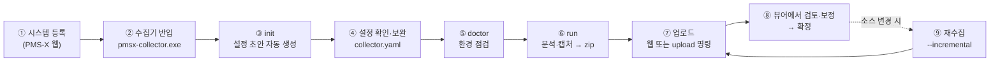
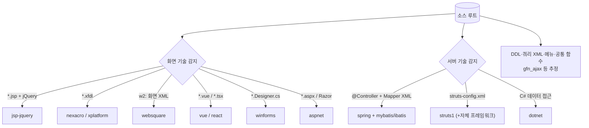
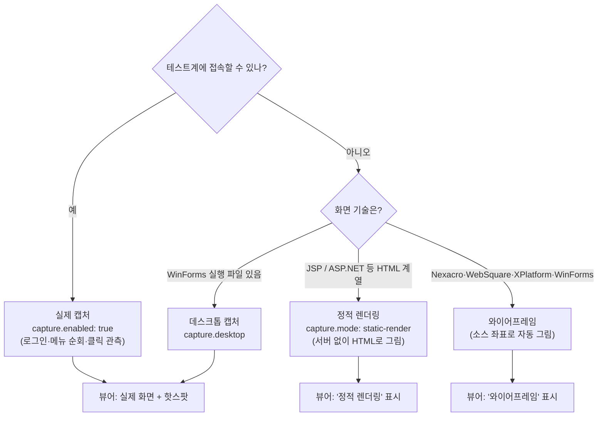
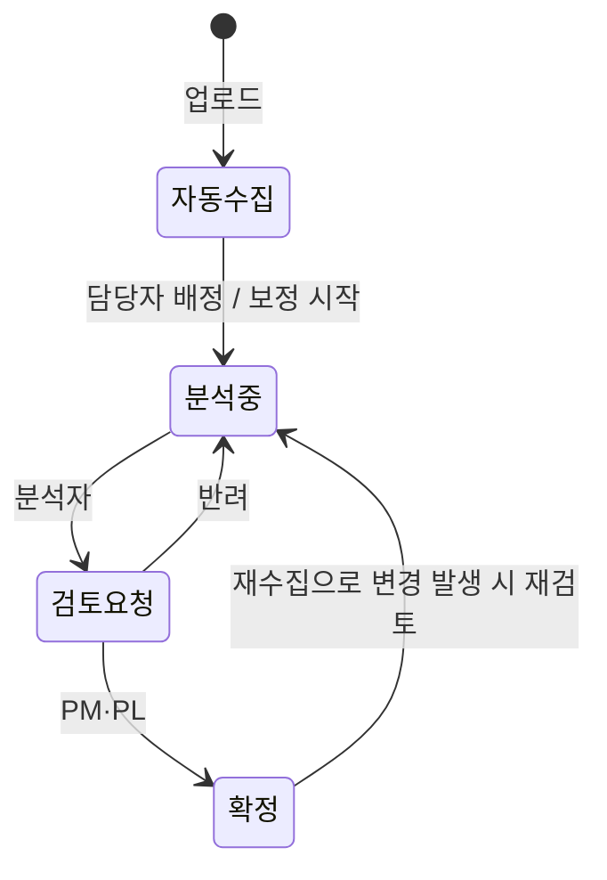

# 16. 새 시스템 As-Is 추가 매뉴얼

- 문서 버전: v1.0 (2026-10-16)
- 대상: 분석 담당자(ANALYST)·PL. 새 고객사·새 레거시 시스템을 PMS-X 화면 분석 뷰어에 올리는 전체 절차.
- 함께 볼 문서: 수집기 상세 설정 `pmsx-collector/README.md`, 중간모델 `docs/04`, 사용자 가이드 `docs/15`

---

## 0. 한눈에 보기



| 단계 | 누가 | 어디서 | 소요(예) |
|---|---|---|---|
| ① 시스템 등록 | PL·분석자 | PMS-X 웹 | 2분 |
| ②~⑥ 수집 | 분석자 | **고객망 안 분석 PC** | 설정 30분 + 실행 수 분~수십 분 |
| ⑦ 업로드 | 분석자 | 웹 / 명령 | 1분 |
| ⑧ 검토·보정 | 분석자 → PL 확정 | PMS-X 웹 | 화면 수에 비례 |

> 실적 예: 실제 운영 중인 Struts 1 + 자체 프레임워크 LMS(화면 약 1,800개)를 **테스트 서버 없이** 정적 분석 4분 + 정적 렌더링 10분으로 올렸다. 서버로 요청하는 버튼 기준 SQL 도달 83%.

---

## 1. 준비물 체크리스트

| 항목 | 필수 | 비고 |
|---|---|---|
| 화면·서버 **소스** (읽기 권한) | ✅ | 형상관리에서 내려받은 폴더. 수집기는 소스를 **수정하지 않음** |
| 분석 PC (Windows 10/11) | ✅ | 디스크 여유 수 GB. Chrome 또는 Edge 설치(캡처·렌더링에 사용) |
| `pmsx-collector.exe` | ✅ | 설치 패키지 또는 빌드 산출물(약 70MB). Python 불필요 |
| DB **읽기 전용** 계정 | 권장 | 테이블·컬럼·PK·FK·SP 메타 → ERD·추정 관계 품질이 크게 오름. 없으면 DDL 파일 또는 SQL에서 추정 |
| 메뉴 테이블 조회 SQL 또는 메뉴 CSV | 권장 | 없으면 화면 폴더 구조로 메뉴를 만든다 |
| 테스트계 URL + 테스트 계정 | 선택 | 있으면 **실제 화면 캡처 + 버튼 클릭 관측**. **운영계 금지** |
| PMS-X 계정 (ANALYST 이상) | ✅ | 업로드·보정용 |

---

## 2. ① PMS-X에 시스템 등록

1. 웹 로그인 → 상단에서 **프로젝트 선택**.
2. **As-Is 분석 › 시스템 관리 → 시스템 등록**.
3. 입력
   - **시스템 코드**: 영문 대문자 짧게(`HR`, `EDU`, `PAY`). **수집기 설정의 `system.code` 와 반드시 같아야** 업로드된다.
   - 시스템명, 화면 기술, 서버 기술, DB 종류, 테스트 URL(선택).

---

## 3. ② 수집기 반입

- 망분리 환경: `pmsx-collector.exe` 한 파일만 반입한다.
- 작업 폴더 예: `D:\pmsx-work\HR\` (설정·결과를 여기에 둔다. 소스 폴더 안에 두지 않는다).

```bat
D:\pmsx-work\HR> pmsx-collector.exe --help
```

---

## 4. ③ init — 설정 초안 자동 생성

```bat
pmsx-collector.exe init D:\src\hr-web --code HR --name 인사시스템
```

소스를 훑어 아래를 **자동 감지**하고 `collector.yaml` 을 만든다. 감지 근거는 파일 안 주석으로 남는다.



> init 이 만든 설정은 **캡처가 꺼진 상태**다. 먼저 정적 분석으로 결과를 보고, 필요하면 캡처를 켠다.

---

## 5. ④ collector.yaml 확인·보완

### 5.1 반드시 확인할 것

```yaml
system:
  code: HR                 # ① 에서 등록한 코드와 동일
  name: 인사시스템
  uiTech: jsp-jquery
  serverTech: [spring]

source:
  root: D:/src/hr-web      # 소스 루트 (읽기 전용으로만 사용)

frontApis:                 # 프로젝트 공통 호출 함수 — init 추정값 확인
  gfn_ajax: { urlArg: 0 }
frontNavigations:
  gfn_popup: { urlArg: 0, kind: popup }

output: D:/pmsx-work/HR/out
```

### 5.2 DB 메타 (권장)

```yaml
db:
  type: oracle             # oracle | tibero | postgresql | mssql | mysql | mariadb
  schemas: [HR]
  connection:
    host: 10.0.0.5
    port: 1521
    service: HRDEV
    user: PMSX_RO          # 읽기 전용 계정
    passwordEnv: PMSX_DB_PW   # 비밀번호는 환경변수로만
```
- 카탈로그 **SELECT 만** 실행하고 rollback 후 종료한다. DB 접속이 안 되면 `db.ddlFiles` 로 DDL 파일을 주거나 생략(SQL에서 테이블 추정).

### 5.3 메뉴 (하나 선택)

| 방식 | 설정 | 언제 |
|---|---|---|
| DB 조회 | `menu.query: "SELECT MENU_ID, UP_MENU_ID, MENU_NM, MENU_URL, SORT_ORD FROM TB_MENU WHERE …"` | 메뉴 테이블이 있을 때 (권장) |
| CSV / INSERT SQL | `menu.csv` / `menu.sqlFile` | DB 접속이 안 될 때 |
| SPA 라우터 | `menu.router: true` | Vue/React |
| Nexacro Dataset | `menu.nexacroDataset` | Nexacro |
| 폴더 구조 | `menu.directory` | 메뉴 정보가 전혀 없을 때 |

### 5.4 화면 기술별 핵심 설정

| 기술 | 꼭 볼 설정 |
|---|---|
| JSP + jQuery | `frontApis`, `frontNavigations`, `source.commonScripts`, (레거시) `source.jspIncludes`·`jspVars`·`scriptRoots` |
| Struts 1 + 자체 프레임워크 | `struts.configs`, `struts.beanConfigs`, `struts.workerActions`(Action 타입·서비스 빈 속성·메서드 접두어), `struts.queryCalls`(쿼리 호출 메서드), `queryXml.files` |
| Nexacro / XPlatform / MiPlatform | `nexacro.services`, `nexacro.serviceUrls`(`svc::` → 서버 경로) |
| WebSquare | `websquare.urlPrefix`, `websquare.submissionCallers` |
| Vue / React | `spa.router`, `spa.alias`, `spa.apiBaseUrl`, `spa.httpClients` |
| WinForms | `source.dotnet`, (캡처) `capture.desktop.exe` |
| ASP.NET | `aspnet.views`, `aspnet.webRoot` |

> **자체 프레임워크**(회사 공통 Action·Service 래퍼)는 클래스명·메서드 접두어·쿼리 호출 메서드명을 설정으로 알려 주면 같은 방식으로 따라간다. 예: `WorkerAction` + `command="SmsService"` + `method=save` → `SmsService.doSave()` → `dataAccesser.query("ID")` → 쿼리 XML.

### 5.5 화면 그림 얻는 방법 고르기



| 방식 | 장점 | 한계 |
|---|---|---|
| **실제 캡처** | 실제 화면, 버튼 클릭으로 호출 API **동적 확인**(신뢰도↑) | 테스트계·테스트 계정 필요 |
| **정적 렌더링** | 서버 없이 실제와 같은 레이아웃·버튼 | 조회 데이터·콤보 값 비어 있음, ajax로 그리는 부분 없음 |
| **와이어프레임** | 런타임 없이 소스 좌표만으로 | 박스·라벨 위주 그림 |
| **수동 캡처** | 어떤 경우든 가능 | 뷰어 편집 모드에서 이미지 업로드 + 핫스팟 직접 배치 |

#### 실제 캡처 설정 (테스트계)

```yaml
capture:
  enabled: true
  baseUrl: https://hr-dev.example.local
  denyHosts: [hr.example.local]        # 운영계 — 일치하면 실행 거부
  login:
    url: /login.do
    steps:
      - fill: { selector: "#userId", valueEnv: PMSX_TEST_ID }
      - fill: { selector: "#userPw", valueEnv: PMSX_TEST_PW }
      - click: "#btnLogin"
  allowRequests: ["*/list.do", "*/select*.do"]   # 조회성 POST 는 통과
  dangerLabels: [삭제, 저장, 승인, 결재, 전송, 확정]
  maskSelectors: ["#jumin", ".phone"]             # 캡처 시 블러
```

**안전 규칙 (끌 수 없음)**: 저장·삭제 같은 변경 요청(POST/PUT/PATCH/DELETE)은 **기록 후 차단**되어 서버에 도달하지 않는다. 위험 라벨 버튼은 누르지 않는다. alert/confirm 은 자동 취소, 운영계 주소는 실행 거부.

---

## 6. ⑤ doctor — 실행 전 점검

```bat
set PMSX_DB_PW=********
pmsx-collector.exe doctor -c collector.yaml
```

| 점검 | 실패 시 |
|---|---|
| 설정·소스 경로·출력 폴더 쓰기·디스크 | 경로 오타·권한 확인 |
| 브라우저 실행(Chrome/Edge) | `capture.browserChannel: msedge` 또는 `capture.browserPath` |
| 대상 URL 응답·운영계 차단 | VPN·방화벽, `denyHosts` 확인 |
| DB 드라이버·접속(읽기 전용 1건) | 계정·포트·서비스명, Tibero ODBC 설치 |
| 한글 글꼴(와이어프레임) | `wireframe.font` 지정 |

실패가 하나라도 있으면 종료코드 1. `--skip browser,network,db` 로 해당 점검을 건너뛸 수 있다.

---

## 7. ⑥ run — 분석·캡처

```bat
pmsx-collector.exe run -c collector.yaml --no-capture    :: 1차: 정적 분석만 (빠름)
pmsx-collector.exe run -c collector.yaml                 :: 2차: 캡처/렌더링 포함
```

결과:
```
out\
├── pmsx-HR-20261016-101500.zip     ← 업로드할 패키지 (model.json + captures + report.html)
└── HR-20261016-101500\report.html  ← 실행 리포트
```

### 실행 리포트에서 볼 것

| 지표 | 의미 | 목표(참고) |
|---|---|---|
| 요소 매칭률 | 캡처 요소 ↔ 소스 요소 대응 | 90% 이상 |
| 버튼 → 핸들러 | 버튼에 연결된 JS/코드 함수 | 90% 이상 |
| 버튼 → API/서버 | 서버까지 이어진 버튼 | 화면 안 동작 버튼 제외 기준 90% 이상 |
| 버튼 → SQL·테이블 | 데이터까지 이어진 버튼 | 80% 이상 |
| 미연결 버튼과 원인 | 핸들러 없음 / 동적 바인딩 / 외부 함수 / 화면 이동만 / 화면 내 동작 | 원인별로 설정 보완 |
| 차단된 요청 | 캡처 중 막은 변경 요청 | 서버 도달 0건 |

> 연결률이 낮으면 대부분 **공통 함수 설정 누락**(`frontApis`, `struts.queryCalls` 등)이다. 리포트의 "미연결 원인 예시"를 보고 설정을 보완한 뒤 다시 실행한다.

---

## 8. ⑦ 업로드

**A. 웹 (망분리 — zip 반출 후)**
As-Is 분석 › 수집 이력/업로드 → 시스템 선택 → zip 업로드 → 회차·변경 요약 확인.

**B. 명령 (망 연결)**
```bat
set PMSX_UPLOAD_PW=********
pmsx-collector.exe upload -c collector.yaml --server https://pmsx.example.local --user analyst
```

업로드 규칙:
- 같은 키(화면·요소·함수·SQL)는 **덮어쓰기**, 이번 회차에 없는 것은 삭제하지 않고 "이전 회차"로 남는다.
- **수동 보정(핫스팟·연결·메모·확정)은 재업로드해도 유지**된다.

---

## 9. ⑧ 뷰어에서 검토·보정·확정



1. **분석 진척 현황**에서 화면을 여러 개 골라 담당자 일괄 배정.
2. **화면 분석 뷰어**에서 화면별로:
   - 점선 핫스팟(핸들러 미매칭) → **편집 모드**에서 핸들러 지정 또는 숨김
   - 점선 연결(신뢰도 90% 미만) → 단계 ⋮ 메뉴로 **확정/기각**, 빠진 연결은 **연결 추가**
   - 업무 규칙은 **메모**(Markdown)로
   - 캡처가 없거나 다르면 **수동 캡처 업로드** 후 핫스팟 배치
3. **ERD**에서 점선(추정 관계) 확정/기각, **테이블 정의서**에서 주제영역·코멘트 정리.
4. 상태를 **검토요청** → PM·PL이 **확정**.
5. **산출물 출력**으로 화면정의서·프로그램 사양서·테이블 정의서 생성.

---

## 10. ⑨ 재수집 (소스가 바뀌었을 때)

```bat
pmsx-collector.exe run -c collector.yaml --incremental
```
- 바뀐 소스가 없으면 이전 결과를 재사용(수 초), 바뀐 화면만 다시 캡처·렌더링한다.
- 테스트계 화면만 바뀐 경우(배포 등)는 감지하지 못하므로 **주기적으로 전체 수집**한다.
- 업로드하면 **수집 이력**에서 회차 간 추가·삭제를 확인할 수 있다.

---

## 11. 문제 해결

| 증상 | 원인 | 조치 |
|---|---|---|
| 업로드 시 `SYSTEM_MISMATCH` | `system.code` 와 서버 시스템 코드 불일치 | 둘 중 하나를 맞춤 |
| 업로드 시 `PACKAGE_INVALID` | 수집기와 서버 버전 차이, zip 손상 | `validate` 명령으로 확인, 수집기 버전 맞춤 |
| 버튼은 많은데 API 연결이 거의 없음 | 공통 호출 함수 미등록 | `frontApis` / `frontNavigations` / `struts.queryCalls` 보완 |
| 서버 함수까지는 가는데 SQL이 없음 | 쿼리 호출 방식 미등록, 파일 처리 | `queryCalls`·`queryXml` 확인 (파일 업·다운로드는 정상) |
| 한글이 깨짐 | 인코딩 | UTF-8/EUC-KR(CP949)은 자동 판별. 그 밖의 인코딩은 UTF-8로 변환한 소스 사본을 분석 |
| 정적 렌더링이 빈 화면 | 내용 전체를 서버 코드로 만드는 화면 | 정상(리포트에 사유 표시). 필요 시 `render.placeholders`·`branchPolicy` 조정 |
| 캡처가 로그인에서 멈춤 | 로그인 셀렉터·보안 프로그램 | `login.steps` 확인, 키보드 보안 모듈은 테스트계에서 해제 요청 |
| 테이블 관계가 없음 | DB 메타·FK 없음 | DB 읽기 전용 계정 연결 또는 DDL 제공, `inference.minEvidence` 조정 |

---

## 12. 보안 수칙

- 소스는 **읽기 전용**으로만 사용하고, 결과 패키지(zip)에는 **소스 일부(함수·SQL 스니펫)가 포함**된다 → 고객사 반출 규정에 따라 관리하고 외부 저장소·메일로 보내지 않는다.
- DB·테스트 계정 비밀번호는 **환경변수로만** (`passwordEnv`, `valueEnv`). 설정 파일에 평문 금지.
- 캡처는 **테스트계에서만**. 운영계 주소는 `denyHosts` 에 등록한다.
- 개인정보가 보이는 영역은 `maskSelectors` 로 블러 처리한다.
