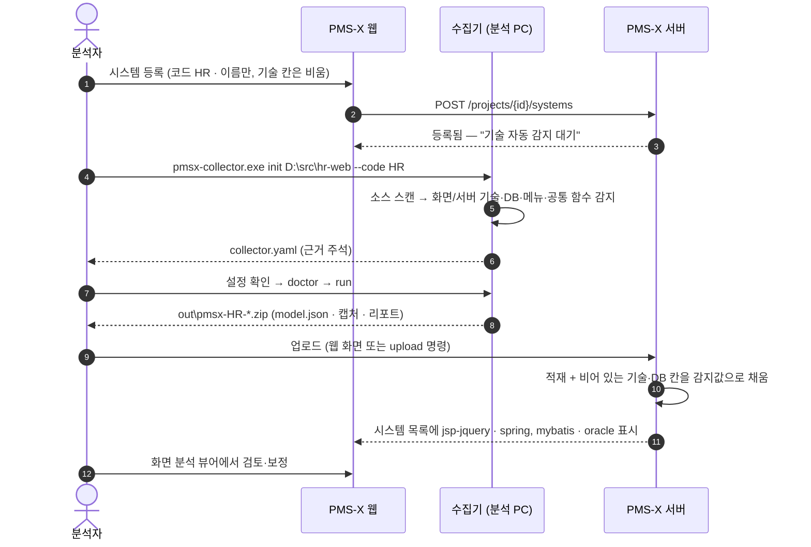
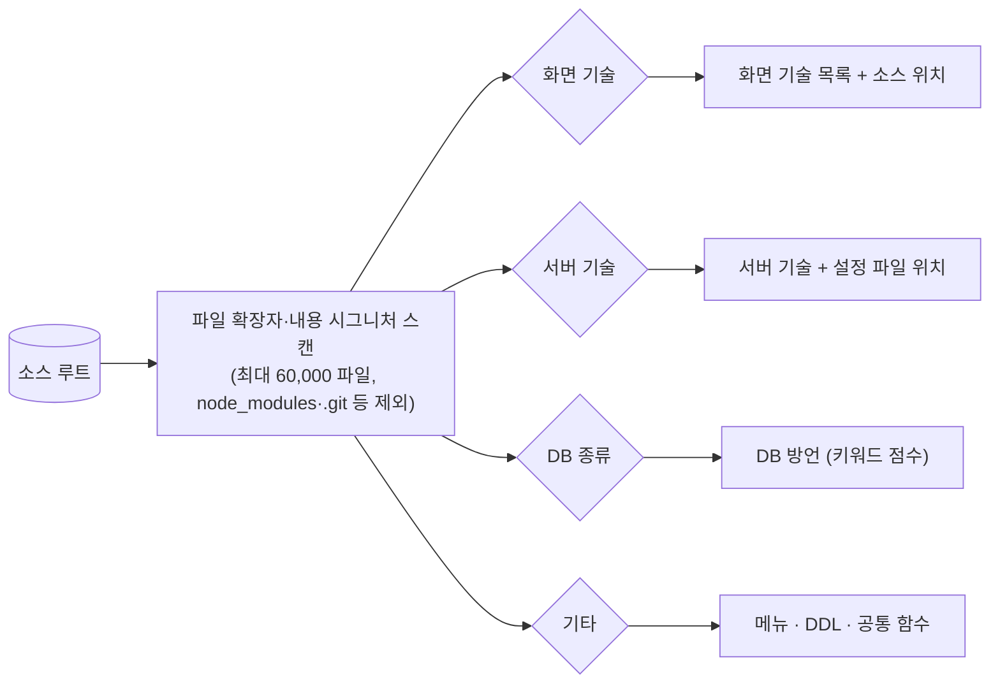

# 17. 시스템 등록 · 기술 자동 감지 가이드

- 문서 버전: v1.0 (2026-10-16)
- 대상: 새 레거시 시스템을 처음 올리는 분석자·PL
- 함께 볼 문서: 전체 절차 [16. 새 시스템 As-Is 추가 매뉴얼](16_신규시스템_AsIs추가_매뉴얼.md), 수집기 상세 [`pmsx-collector/README.md`](../pmsx-collector/README.md)

---

## 1. 핵심 요약

> **시스템 등록은 "코드와 이름"만 하면 된다. 화면 기술·서버 기술·DB 종류는 수집기가 소스를 보고 감지하고, 첫 업로드 때 서버가 자동으로 채운다.**

기술 감지는 **두 곳**에서 일어난다.

| 어디서 | 무엇을 | 결과 |
|---|---|---|
| ① 수집기 `init` (고객망 분석 PC) | 소스 폴더를 훑어 화면·서버 기술, 소스 위치, DDL·쿼리 XML, 메뉴, 공통 함수, DB 종류를 **감지** | `collector.yaml` 초안 (감지 근거 주석 포함) |
| ② 서버 업로드 (PMS-X) | 패키지(`model.json` 의 `system.uiTech·serverTech·dbType`)를 보고, 시스템 등록 때 **비워 둔 칸만** 채움 | 시스템 목록에 감지된 기술 표시 |

PMS-X 서버는 고객망 소스에 직접 접근하지 않는다(폐쇄망·보안). 그래서 감지는 소스가 있는 분석 PC의 수집기가 하고, 서버는 그 결과를 받아 반영한다.

---

## 2. 전체 흐름



---

## 3. 단계별 따라하기

### 3.1 시스템 등록 (웹)

**As-Is 분석 › 시스템 관리 › 시스템 등록**

| 칸 | 입력 | 비고 |
|---|---|---|
| 시스템 코드 | `HR` | **필수**. 영문 대문자·숫자·`_`. 수집기 `--code` 와 같아야 업로드된다 |
| 시스템명 | `인사시스템` | **필수** |
| 화면 기술 | (비워 둠) | 비우면 첫 업로드 때 자동 채움. 알고 있으면 직접 골라도 된다 |
| 서버 기술 | (비워 둠) | 〃 |
| DB 종류 | `자동 감지 (첫 수집 결과로)` | 〃 |
| 테스트계 URL | 선택 | 캡처할 때 참고 |

등록 직후 목록에는 **"기술 자동 감지 대기"** 칩이 보인다.

> 직접 입력한 값은 **업로드해도 덮어쓰지 않는다.** 감지값으로 바꾸고 싶으면 칸을 비워 두거나, 나중에 관리자가 수정한다.

### 3.2 init — 소스에서 기술 감지 (분석 PC)

```bat
pmsx-collector.exe init D:\src\hr-web --code HR --name 인사시스템
```

출력 예 (저장소의 `samples/hr-legacy` 로 실제 실행한 결과):
```
[pmsx-collector] 설정 초안 생성: D:\src\hr-web\collector.yaml
  화면 기술 jsp-jquery · 서버 기술 spring, mybatis · DB oracle
    [화면] jsp-jquery: JSP 6개 (예: src/main/webapp/WEB-INF/jsp/hr/appoint/HR0103.jsp)
    [서버] spring: Spring 컨트롤러 5개 (예: src/main/java/kr/go/cmm/code/web/CmmCodeController.java)
    [서버] mybatis: MyBatis/iBatis 매퍼 5개 (예: src/main/resources/mapper/cmm/CmmCodeMapper.xml)
  공통 함수 추정: 요청 gfn_ajax, gfn_setCombo, gfn_excel · 화면 이동 gfn_popup
  다음 단계: 파일의 TODO(시스템 코드·캡처 설정)를 확인한 뒤 doctor → run
```

생성된 `collector.yaml` 에는 **왜 그렇게 판단했는지** 근거가 주석으로 붙는다 (발췌):

```yaml
system:
  code: HR                        # TODO 시스템 코드 (서버에 등록한 시스템 코드와 같게)
  name: "인사시스템"
  uiTech: [jsp-jquery]
  serverTech: [spring, mybatis]
  dbType: oracle                   # 근거: oracle 키워드 46회

# 감지 근거
#   [화면] jsp-jquery: JSP 6개 (예: src/main/webapp/WEB-INF/jsp/hr/appoint/HR0103.jsp)
#   [서버] spring: Spring 컨트롤러 5개 (예: src/main/java/kr/go/cmm/code/web/CmmCodeController.java)
#   [서버] mybatis: MyBatis/iBatis 매퍼 5개 (예: src/main/resources/mapper/cmm/CmmCodeMapper.xml)

source:
  webapp: ".../src/main/webapp"
  jsp: ".../src/main/webapp/WEB-INF/jsp"
  java: ".../src/main/java"
  mapper: ".../src/main/resources/mapper"
  commonScripts: [/js/cmm/]

# 공통 함수 → 요청/화면 이동 해석 규칙 (소스에서 추정 — 반드시 확인)
frontApis:
  gfn_ajax: { urlArg: 0, method: POST }
  gfn_excel: { urlArg: 0, method: GET }
  gfn_setCombo: { urlArg: 1, method: GET }
frontNavigations:
  gfn_popup: { urlArg: 0 }

db:
  ddlFiles: [".../db/ddl.sql", ".../db/procedures.sql"]   # DB 접속 없이 DDL로 메타 수집
```

### 3.3 확인 → doctor → run → 업로드

```bat
notepad collector.yaml                      :: 감지 결과·TODO 확인
pmsx-collector.exe doctor -c collector.yaml
pmsx-collector.exe run -c collector.yaml
pmsx-collector.exe upload -c collector.yaml --server https://pmsx.local --user analyst
```

업로드가 끝나면 시스템 목록의 "기술 자동 감지 대기"가 감지된 기술 칩(`jsp-jquery`, `spring`, `mybatis`)과 DB 종류(`oracle`)로 바뀐다.

---

## 4. 무엇을 보고 감지하나



### 4.1 화면 기술

| 감지 값 | 시그니처 | 함께 정하는 설정 |
|---|---|---|
| `jsp-jquery` | `*.jsp` 존재 (+ `jquery*.js`) | `source.webapp`(WEB-INF 상위), `source.jsp`, 공통 스크립트 폴더(cmm·common) |
| `nexacro` | `*.xfdl` 중 `<FDL version="2.x">` 또는 `<Layouts>` | `source.nexacro`(TypeDefinition 위치), 서비스 폴더, `svc::` URL, 메뉴 Dataset |
| `xplatform` | `*.xfdl` 중 FDL 1.x(Layouts 없음) | `source.xplatform`, `Dialog` 팝업 함수 |
| `miplatform` | `*.xml` 안 `<Window>` + `<Form>` | 〃 |
| `websquare` | `*.xml` 안 `xmlns:w2=` / `<w2:` | `source.websquare`, URL 접두, 공통 스크립트, submission 호출 함수 |
| `vue` | `*.vue` (+ `package.json` 의 vue) | `source.vue`, 라우터 파일, `@` 별칭, 메뉴=라우터 |
| `react` | JSX/TSX 컴포넌트 | `source.react`, React Router |
| `winforms` | `*.Designer.cs` | `source.dotnet`, 메뉴=MenuStrip |
| `aspnet-webforms` | `*.aspx` | 웹 루트 |
| `aspnet-mvc` | `Views/**/*.cshtml` + `Controllers` | 뷰 폴더 |

### 4.2 서버 기술

| 감지 값 | 시그니처 |
|---|---|
| `spring` | `@Controller` / `@RestController` 클래스 |
| `mybatis` | Mapper XML(`<mapper namespace>`), iBatis `<sqlMap>` |
| `struts1` | `struts*.xml` 의 `<action path=…>` — action 수와 Worker류 자체 Action 타입까지 추정(`struts.workerActions`) |
| `queryxml` | `<query><id>…</id><value>SQL</value>` 형태의 쿼리 정의 XML (자체 프레임워크) |
| `dotnet` | `*.cs` + 데이터 접근(SqlCommand·Dapper·DbContext) |

### 4.3 DB 종류

DDL·SQL 파일의 방언 키워드를 점수로 센다 (예: Oracle `NVL`·`SYSDATE`·`VARCHAR2`·`NUMBER`, MSSQL `GETDATE`·`NVARCHAR`·`IDENTITY`, PostgreSQL `SERIAL`·`::` 형변환, MySQL `AUTO_INCREMENT`). 가장 높은 점수의 방언과 근거를 주석으로 남긴다. DDL이 없으면 쿼리 XML·Mapper 의 SQL로 판단한다.

### 4.4 기타

| 항목 | 감지 방법 |
|---|---|
| DDL 파일 | `CREATE TABLE / PROCEDURE / FUNCTION / PACKAGE` 를 담은 `*.sql` |
| 메뉴 | 메뉴 CSV, Nexacro 메뉴 Dataset, SPA 라우터, WinForms MenuStrip — 없으면 폴더 구조 |
| 공통 함수 | JS 함수 본문에서 `$.ajax({url: 인자})`, `location.href = 인자`, `transaction(…, 인자)`, `window.open(인자)`, `showModal` 등을 찾아 **요청 래퍼**(`frontApis`)·**화면 이동/팝업 래퍼**(`frontNavigations`)로 등록, 한 단계 감싼 함수까지 전파 |
| 데스크톱 실행 파일 | WinForms 빌드 산출물 `bin/**/*.exe` |

---

## 5. 감지가 틀리거나 비었을 때

| 증상 | 조치 |
|---|---|
| 화면 기술이 비었다 ("⚠ 화면 기술을 찾지 못했습니다") | 소스 루트를 한 단계 위/아래로 바꿔 다시 `init`, 또는 `system.uiTech` 직접 지정 |
| 화면 기술이 여러 개 감지됨 | 실제로 섞인 시스템이면 그대로 둔다(수집기가 모두 분석). 불필요한 폴더(백업·샘플)는 `source.*` 경로를 좁힌다 |
| 서버 기술이 `spring` 인데 실제는 자체 프레임워크 | `struts.workerActions`·`struts.queryCalls` 등 규칙을 설정 ([16번 매뉴얼 5.4](16_신규시스템_AsIs추가_매뉴얼.md)) |
| DB 종류가 틀림 | `db.type` 직접 지정 (또는 `db.connection` 으로 실제 DB 메타 수집) |
| 공통 함수 추정이 틀림 | `frontApis` / `frontNavigations` 의 `urlArg`(URL 인자 위치)·`method` 수정 → `run` 후 리포트의 연결률 확인 |
| 서버 시스템 목록이 업로드 후에도 "감지 대기" | 패키지 `model.json` 의 `system.uiTech` 가 비어 있음 → 설정에 `uiTech` 지정 후 재수집 |
| 등록 때 잘못 입력한 기술이 그대로 남음 | 업로드는 입력값을 덮어쓰지 않음 → 관리자가 시스템 정보를 수정 |

---

## 6. 자주 묻는 질문

**Q. 웹에 시스템만 등록하면 서버가 알아서 소스를 분석하나?**
A. 아니다. PMS-X 서버는 고객 소스에 접근하지 않는다. 분석은 고객망의 분석 PC에서 수집기가 하고, 그 결과(zip)를 올리는 구조다. 시스템 등록은 "결과를 받을 자리"를 만드는 일이다.

**Q. 기술 칸을 꼭 비워야 하나?**
A. 아니다. 알고 있으면 입력해도 된다. 다만 입력한 값은 업로드로 덮어쓰지 않으므로, 감지 결과를 믿고 싶으면 비워 두는 편이 편하다.

**Q. 같은 시스템을 다시 수집하면?**
A. 같은 코드로 다시 업로드하면 새 회차로 쌓인다. 기술 칸은 이미 채워져 있으면 바뀌지 않는다. 수동 보정(핫스팟·연결·메모·확정)도 유지된다.

**Q. 테스트 서버가 없어도 되나?**
A. 된다. `init` 이 만든 설정 그대로(캡처 꺼짐) 정적 분석만 해도 버튼 → 함수 → 서버 → SQL → 테이블 연결이 나온다. 화면 그림은 JSP 계열이면 `capture.mode: static-render`(정적 렌더링), Nexacro·WebSquare·WinForms 는 와이어프레임으로 자동 생성된다.
